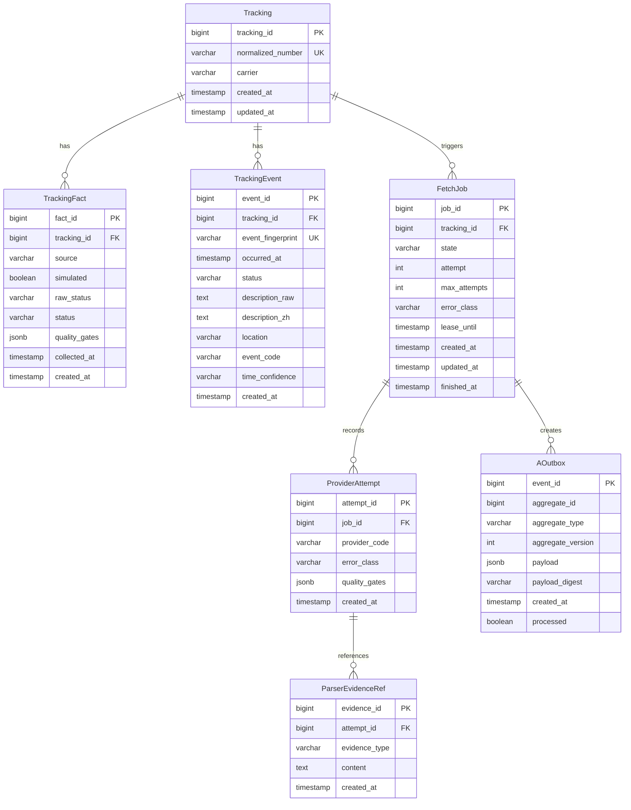
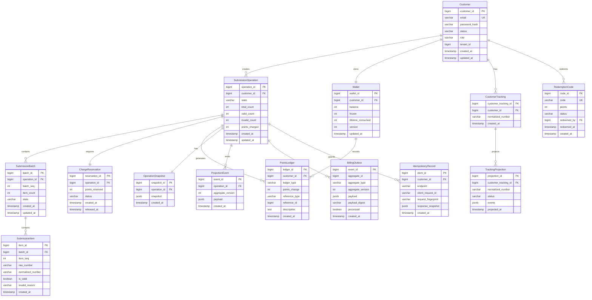

# USPS 单号查询系统 05：数据模型与数据库

## 1. 模块目标

定义系统的数据权威、A/B 库 schema、实体关系、索引、事务、版本和恢复规则，保证账务不丢不重、采集事实可追踪、客户投影可重放、队列可从 PostgreSQL 恢复。

## 2. 功能范围

- A 库：采集事实、事件、任务、解析证据和采集 outbox。
- B 库：客户、钱包、流水、reservation、操作、提交明细、客户关系、投影和业务 outbox。
- 数据类型、主外键、唯一约束、索引、保留期、迁移兼容和恢复重建。
- A/B 单向摆渡、投影版本、幂等重放、对账和审计字段。

不包含：业务清洗规则/计费决策（06）、Provider 抓取和调度（02/07）、页面布局（03/04）。

## 3. 关键设计

### 3.1 A/B 权威划分

A 库权威实体：`Tracking`、`TrackingFact`、`TrackingEvent`、`FetchJob`、`ProviderAttempt`、`ParserEvidenceRef`、`AOutbox`、`ProviderHealth`、`FetchAttemptLog`。tracking 唯一键为 `(normalized_number, carrier)`；事件按稳定 event fingerprint 去重；任务以稳定 job ID、状态、租约、重试预算和 provider/config 版本记录。

B 库权威实体：`Tenant`、`Seat`、`AdminUser`、`Customer`、`Wallet`、`PointsLedger`、`ChargeReservation`、`SubmissionOperation`、`SubmissionBatch`、`SubmissionItem`、`CustomerTracking`、`TargetGroup`、`ImportJob`、`ExportJob`、`Session`、`AuditLog`、`RefreshBudget`、`TrackingProjection`、`OperationSnapshot`、`ProjectionEvent`、`IdempotencyRecord`、`BillingOutbox`、`BillingChargeWindow`、`RedemptionCode`。新增/补全表见 §5.5（E2 裁定）。

全部对外业务表在内部 bigint 主键之外增加 `public_id UUID` 对外标识（防枚举、对齐 09 示例）；客户 API 的轨迹 ID 一律用 B 库 `customer_tracking_id`，不暴露 A 库 `tracking.public_id`（见 11 号文档 §0）。

BFF 只持有 B 库凭据；采集 Worker 只持有必要的 A 库权限；sync-agent 使用专用受限身份。生产首版 A/B 可在同一 PostgreSQL 实例内使用独立数据库、角色和连接串；开发、验收、生产不得共享实例或秘密。

### 3.2 事务与唯一性

- B 库 commit 事务原子写 operation、原文引用、计费 reservation、幂等记录、流水和 outbox。
- FetchJob 领取通过数据库 lease/条件更新完成；过期租约可回收。
- Worker 将事实、事件和 AOutbox 在同一事务写入后再确认队列消息。
- sync-agent 使用 `event_id + aggregate_version` 幂等投影；账务镜像用 `event_id + payload_digest` 幂等。
- 关键唯一约束包括：tracking 规范化键、customer_tracking 客户关系、活动 single-flight job、operation/batch 序号、明细行号/候选序号、幂等作用域、outbox event ID。
- 钱包和 charge subject 的锁顺序固定，按稳定单号序排序，避免死锁；不能以自然月字段替代滚动 30 天资格语义。

### 3.3 Redis 和事件重建

Redis 只做 broker 和短期缓存。任务表中的 `pending / claimed / lease_expires_at / retry_at` 是重建 Redis 的依据。SSE 事件不是唯一状态源，快照和 B 库投影是恢复依据。对账追加修正流水，不修改历史流水或直接修钱包余额。

### 3.4 数据保留和隐私

单号、原文、页面证据和浏览器状态按最小必要原则分别设定保留期；普通日志不得记录完整单号或凭据。每类数据必须明确 owner、访问角色、加密方式、过期清理和审计要求。真实客户数据不得进入开发区、CI 或合成测试样本。

按已定数据保留规则，回收站 30 天、上传文件 ≤64 MB（对应单次最多 1,000,000 条候选）、导出文件 7 天；数据库只保留必要元数据和引用，文件内容由存储层按有效期清理。A 库账务镜像通过 `event_id + payload_digest` 幂等重试，日对账只做补偿，不改历史流水或直接改余额。首版 A/B 为同一 PostgreSQL 实例内两个独立数据库和角色，属于逻辑隔离，不宣称物理隔离。

## 4. 模块间依赖

依赖 00 的 A/B 原则和 01 的数据库版本/隔离环境；为 02 提供采集事实 schema，为 03 提供运营查询模型，为 04 提供客户投影，为 06 提供账务事务，为 07 提供任务/租约状态，为 09 提供 API 数据契约。

## 5. ER 图与字段级 Schema

### 5.1 A 库 ER 图

### 5.2 B 库 ER 图

### 5.3 A 库字段级 Schema

#### `tracking` 表

| 字段名 | 类型 | 约束 | 说明 |
|---|---|---|---|
| `tracking_id` | BIGSERIAL | PRIMARY KEY | 自增主键 |
| `public_id` | UUID | NOT NULL UNIQUE DEFAULT gen_random_uuid() | 对外 ID（A 库内部标识，不暴露给客户 API） |
| `normalized_number` | VARCHAR(50) | NOT NULL | 规范化单号 |
| `carrier` | VARCHAR(20) | NOT NULL DEFAULT 'usps' | 承运商代码 |
| `next_sync_at` | TIMESTAMPTZ | | 下次刷新时间（02 §5.7.1 刷新调度依赖） |
| `version` | INT | NOT NULL DEFAULT 0 | 乐观锁版本（07 §3.7 终态保护依赖） |
| `last_success_at` | TIMESTAMPTZ | | 最近一次成功采集时间（终态保护/近期去重依赖） |
| `created_at` | TIMESTAMP | NOT NULL DEFAULT now() | 创建时间 |
| `updated_at` | TIMESTAMP | NOT NULL DEFAULT now() | 更新时间 |

**索引**：
- `UNIQUE (normalized_number, carrier)` — 单号唯一键
- `INDEX idx_tracking_updated_at ON updated_at` — 刷新查询
- `INDEX idx_tracking_next_sync ON next_sync_at` — 刷新调度扫描（C1 补齐，见 11 号文档）

> C1 补齐说明：原表缺 `next_sync_at/version/last_success_at`，但 02 刷新与 07 终态保护依赖这些字段，故补齐。

---

#### `tracking_fact` 表

| 字段名 | 类型 | 约束 | 说明 |
|---|---|---|---|
| `fact_id` | BIGSERIAL | PRIMARY KEY | 自增主键 |
| `tracking_id` | BIGINT | NOT NULL REFERENCES tracking(tracking_id) | 关联单号 |
| `source` | VARCHAR(20) | NOT NULL DEFAULT 'usps_web' | 数据来源 |
| `simulated` | BOOLEAN | NOT NULL DEFAULT false | 是否模拟数据 |
| `raw_status` | TEXT | | 页面原始状态 |
| `status` | VARCHAR(30) | | 标准化状态 |
| `quality_gates` | JSONB | | 质量闸门检查结果 |
| `collected_at` | TIMESTAMP | | 采集时间 |
| `created_at` | TIMESTAMP | NOT NULL DEFAULT now() | 创建时间 |

**索引**：
- `INDEX idx_tracking_fact_tracking_id ON tracking_id`
- `INDEX idx_tracking_fact_collected_at ON collected_at DESC`

---

#### `tracking_event` 表

| 字段名 | 类型 | 约束 | 说明 |
|---|---|---|---|
| `event_id` | BIGSERIAL | PRIMARY KEY | 自增主键 |
| `tracking_id` | BIGINT | NOT NULL REFERENCES tracking(tracking_id) | 关联单号 |
| `event_fingerprint` | VARCHAR(64) | NOT NULL | 事件指纹（去重键） |
| `occurred_at` | TIMESTAMP | | 事件发生时间 |
| `status` | VARCHAR(30) | | 事件状态 |
| `description_raw` | TEXT | | 原始描述 |
| `description_zh` | TEXT | | 中文翻译 |
| `location` | VARCHAR(100) | | 地点 |
| `event_code` | VARCHAR(20) | | 事件代码 |
| `time_confidence` | VARCHAR(10) | | 时间置信度 |
| `created_at` | TIMESTAMP | NOT NULL DEFAULT now() | 创建时间 |

**索引**：
- `UNIQUE (tracking_id, event_fingerprint)` — 事件去重
- `INDEX idx_tracking_event_occurred_at ON occurred_at DESC`

---

#### `fetch_job` 表

| 字段名 | 类型 | 约束 | 说明 |
|---|---|---|---|
| `job_id` | BIGSERIAL | PRIMARY KEY | 自增主键 |
| `tracking_id` | BIGINT | NOT NULL REFERENCES tracking(tracking_id) | 关联单号 |
| `state` | VARCHAR(30) | NOT NULL DEFAULT 'pending' | 任务状态 |
| `attempt` | INT | NOT NULL DEFAULT 0 | 当前尝试次数 |
| `max_attempts` | INT | NOT NULL DEFAULT 3 | 最大尝试次数 |
| `error_class` | VARCHAR(30) | | 错误分类 |
| `queue` | VARCHAR(20) | NOT NULL DEFAULT 'Q_SCHEDULED' | 队列名 |
| `worker_id` | VARCHAR(50) | | 领取的 Worker ID |
| `lease_until` | TIMESTAMP | | 租约到期时间 |
| `retry_at` | TIMESTAMPTZ | | 重试/重建时间（Redis 重建视图依赖，C2 补齐） |
| `created_at` | TIMESTAMP | NOT NULL DEFAULT now() | 创建时间 |
| `updated_at` | TIMESTAMP | NOT NULL DEFAULT now() | 更新时间 |
| `finished_at` | TIMESTAMP | | 完成时间 |

**索引**：
- `INDEX idx_fetch_job_state ON state`
- `INDEX idx_fetch_job_lease_until ON lease_until`
- `INDEX idx_fetch_job_retry_at ON retry_at`
- `UNIQUE (tracking_id) WHERE state IN ('pending','claimed','running','waiting_for_session','retry_scheduled','collecting_response')` — single-flight（C2 修正，见 11 号文档）

> C2 修正说明：原索引仅覆盖 `pending/running`，但 07 §3.1 状态机含 `claimed/waiting_for_session/retry_scheduled/collecting_response` 等活跃态，领取后去重会失效。改为对全部活跃态做 partial unique index（同一 tracking 同时只允许一个活跃 job），终态不占唯一约束。状态枚举须与 02 §3.1、07 一致。

---

#### `provider_attempt` 表

| 字段名 | 类型 | 约束 | 说明 |
|---|---|---|---|
| `attempt_id` | BIGSERIAL | PRIMARY KEY | 自增主键 |
| `job_id` | BIGINT | NOT NULL REFERENCES fetch_job(job_id) | 关联任务 |
| `provider_code` | VARCHAR(20) | NOT NULL | Provider 代码 |
| `error_class` | VARCHAR(30) | | 错误分类 |
| `quality_gates` | JSONB | | 质量闸门结果 |
| `created_at` | TIMESTAMP | NOT NULL DEFAULT now() | 创建时间 |

**索引**：
- `INDEX idx_provider_attempt_job_id ON job_id`
- `INDEX idx_provider_attempt_created_at ON created_at DESC`

---

#### `a_outbox` 表

| 字段名 | 类型 | 约束 | 说明 |
|---|---|---|---|
| `event_id` | BIGSERIAL | PRIMARY KEY | 自增主键 |
| `aggregate_id` | BIGINT | NOT NULL | 聚合根 ID |
| `aggregate_type` | VARCHAR(30) | NOT NULL | 聚合类型 |
| `aggregate_version` | INT | NOT NULL | 聚合版本 |
| `payload` | JSONB | NOT NULL | 事件载荷 |
| `payload_digest` | VARCHAR(64) | NOT NULL | 载荷摘要 |
| `processed` | BOOLEAN | NOT NULL DEFAULT false | 是否已处理 |
| `created_at` | TIMESTAMP | NOT NULL DEFAULT now() | 创建时间 |

**索引**：
- `UNIQUE (aggregate_id, aggregate_type, aggregate_version)` — 幂等
- `INDEX idx_a_outbox_processed ON processed`

---

### 5.4 B 库字段级 Schema

#### `customer` 表

| 字段名 | 类型 | 约束 | 说明 |
|---|---|---|---|
| `customer_id` | BIGSERIAL | PRIMARY KEY | 自增主键 |
| `email` | VARCHAR(100) | NOT NULL UNIQUE | 客户邮箱 |
| `password_hash` | VARCHAR(255) | NOT NULL | 密码哈希 |
| `status` | VARCHAR(20) | NOT NULL DEFAULT 'active' | 账户状态 |
| `role` | VARCHAR(20) | NOT NULL DEFAULT 'member' | 角色 |
| `tenant_id` | BIGINT | | 租户 ID |
| `created_at` | TIMESTAMP | NOT NULL DEFAULT now() | 创建时间 |
| `updated_at` | TIMESTAMP | NOT NULL DEFAULT now() | 更新时间 |

**索引**：
- `UNIQUE (email)` — 邮箱唯一
- `INDEX idx_customer_tenant_id ON tenant_id`

---

#### `wallet` 表

| 字段名 | 类型 | 约束 | 说明 |
|---|---|---|---|
| `wallet_id` | BIGSERIAL | PRIMARY KEY | 自增主键 |
| `customer_id` | BIGINT | NOT NULL UNIQUE REFERENCES customer(customer_id) | 客户 ID |
| `balance` | INT | NOT NULL DEFAULT 0 | 积分余额 |
| `frozen` | INT | NOT NULL DEFAULT 0 | 冻结积分 |
| `lifetime_consumed` | INT | NOT NULL DEFAULT 0 | 累计消费 |
| `version` | INT | NOT NULL DEFAULT 0 | 乐观锁版本 |
| `updated_at` | TIMESTAMP | NOT NULL DEFAULT now() | 更新时间 |

**索引**：
- `UNIQUE (customer_id)` — 一客户一钱包

---

#### `points_ledger` 表

| 字段名 | 类型 | 约束 | 说明 |
|---|---|---|---|
| `ledger_id` | BIGSERIAL | PRIMARY KEY | 自增主键 |
| `customer_id` | BIGINT | NOT NULL REFERENCES customer(customer_id) | 客户 ID |
| `ledger_type` | VARCHAR(20) | NOT NULL | 流水类型 |
| `points_change` | INT | NOT NULL | 积分变动 |
| `reference_type` | VARCHAR(20) | | 引用类型 |
| `reference_id` | BIGINT | | 引用 ID |
| `description` | TEXT | | 描述 |
| `created_at` | TIMESTAMP | NOT NULL DEFAULT now() | 创建时间 |

**索引**：
- `INDEX idx_points_ledger_customer_id ON customer_id`
- `INDEX idx_points_ledger_created_at ON created_at DESC`

---

#### `charge_reservation` 表

| 字段名 | 类型 | 约束 | 说明 |
|---|---|---|---|
| `reservation_id` | BIGSERIAL | PRIMARY KEY | 自增主键 |
| `operation_id` | BIGINT | NOT NULL REFERENCES submission_operation(operation_id) | 关联操作 |
| `points_reserved` | INT | NOT NULL | 预留积分 |
| `status` | VARCHAR(20) | NOT NULL DEFAULT 'reserved' | 预留状态 |
| `created_at` | TIMESTAMP | NOT NULL DEFAULT now() | 创建时间 |
| `released_at` | TIMESTAMP | | 释放时间 |

**索引**：
- `INDEX idx_charge_reservation_operation_id ON operation_id`
- `INDEX idx_charge_reservation_status ON status`

---

#### `submission_operation` 表

| 字段名 | 类型 | 约束 | 说明 |
|---|---|---|---|
| `operation_id` | BIGSERIAL | PRIMARY KEY | 自增主键 |
| `customer_id` | BIGINT | NOT NULL REFERENCES customer(customer_id) | 客户 ID |
| `state` | VARCHAR(20) | NOT NULL DEFAULT 'accepted' | 操作状态 |
| `total_count` | INT | NOT NULL | 总单号数 |
| `valid_count` | INT | NOT NULL | 有效单号数 |
| `invalid_count` | INT | NOT NULL DEFAULT 0 | 无效单号数 |
| `points_charged` | INT | NOT NULL DEFAULT 0 | 实际扣费 |
| `created_at` | TIMESTAMP | NOT NULL DEFAULT now() | 创建时间 |
| `updated_at` | TIMESTAMP | NOT NULL DEFAULT now() | 更新时间 |

**索引**：
- `INDEX idx_submission_operation_customer_id ON customer_id`
- `INDEX idx_submission_operation_created_at ON created_at DESC`

---

#### `submission_batch` 表

| 字段名 | 类型 | 约束 | 说明 |
|---|---|---|---|
| `batch_id` | BIGSERIAL | PRIMARY KEY | 自增主键 |
| `operation_id` | BIGINT | NOT NULL REFERENCES submission_operation(operation_id) | 关联操作 |
| `batch_seq` | INT | NOT NULL | 批次序号 |
| `item_count` | INT | NOT NULL | 明细数量 |
| `state` | VARCHAR(20) | NOT NULL DEFAULT 'pending' | 批次状态 |
| `created_at` | TIMESTAMP | NOT NULL DEFAULT now() | 创建时间 |
| `updated_at` | TIMESTAMP | NOT NULL DEFAULT now() | 更新时间 |

**索引**：
- `UNIQUE (operation_id, batch_seq)` — 批次序号唯一
- `INDEX idx_submission_batch_state ON state`

---

#### `submission_item` 表

| 字段名 | 类型 | 约束 | 说明 |
|---|---|---|---|
| `item_id` | BIGSERIAL | PRIMARY KEY | 自增主键 |
| `batch_id` | BIGINT | NOT NULL REFERENCES submission_batch(batch_id) | 关联批次 |
| `item_seq` | INT | NOT NULL | 明细序号 |
| `raw_number` | VARCHAR(100) | NOT NULL | 原始单号 |
| `normalized_number` | VARCHAR(50) | | 规范化单号 |
| `is_valid` | BOOLEAN | NOT NULL DEFAULT true | 是否有效 |
| `invalid_reason` | VARCHAR(50) | | 无效原因 |
| `created_at` | TIMESTAMP | NOT NULL DEFAULT now() | 创建时间 |

**索引**：
- `UNIQUE (batch_id, item_seq)` — 明细序号唯一
- `INDEX idx_submission_item_normalized_number ON normalized_number`

---

#### `customer_tracking` 表

| 字段名 | 类型 | 约束 | 说明 |
|---|---|---|---|
| `customer_tracking_id` | BIGSERIAL | PRIMARY KEY | 自增主键 |
| `customer_id` | BIGINT | NOT NULL REFERENCES customer(customer_id) | 客户 ID |
| `normalized_number` | VARCHAR(50) | NOT NULL | 规范化单号 |
| `created_at` | TIMESTAMP | NOT NULL DEFAULT now() | 创建时间 |

**索引**：
- `UNIQUE (customer_id, normalized_number)` — 客户-单号关系唯一
- `INDEX idx_customer_tracking_customer_id ON customer_id`

---

#### `idempotency_record` 表

| 字段名 | 类型 | 约束 | 说明 |
|---|---|---|---|
| `idem_id` | BIGSERIAL | PRIMARY KEY | 自增主键 |
| `customer_id` | BIGINT | NOT NULL REFERENCES customer(customer_id) | 客户 ID |
| `endpoint` | VARCHAR(50) | NOT NULL | 端点路径 |
| `client_request_id` | VARCHAR(50) | NOT NULL | 客户端请求 ID |
| `request_fingerprint` | VARCHAR(64) | NOT NULL | 请求指纹 |
| `response_snapshot` | JSONB | | 响应快照 |
| `created_at` | TIMESTAMP | NOT NULL DEFAULT now() | 创建时间 |

**索引**：
- `UNIQUE (customer_id, endpoint, client_request_id)` — 幂等键

---

### 5.5 补全表（E2：03/04 功能要求、原 schema 缺失，P0 一次性补齐）

> 依据 03/04 功能清单与 09 权限模型补齐；下表字段为最小必要集，详细约束随迁移落地。对外业务表统一加 `public_id UUID NOT NULL UNIQUE DEFAULT gen_random_uuid()`（对外 ID 裁定见 11 号文档 §0）。

**B 库（客户业务/账务/管理）**：

| 表 | 用途 | 关键字段 |
|---|---|---|
| `tenant` | 租户 | `tenant_id` PK、`name`、`status`、`created_at` |
| `seat` | 席位 | `seat_id` PK、`tenant_id` FK、`customer_id` FK、`role`、`status` |
| `admin_user` | 管理员账号 | `admin_id` PK、`username` UNIQUE、`password_hash`、`role`、`status` |
| `target_group` | 目标分组（04 分组呈现） | `group_id` PK、`customer_id` FK、`name`、`created_at` |
| `import_job` | 异步导入任务（04 百万级导入页） | `import_job_id` PK、`customer_id` FK、`status`、`total`、`done` |
| `export_job` | 异步导出任务 | `export_job_id` PK、`customer_id` FK、`status`、`file_ref`、`created_at` |
| `audit_log` | 管理/高风险操作审计（03/09） | `audit_id` PK、`actor_id`、`actor_role`、`action`、`target`、`detail` JSONB、`created_at` |
| `session` | 登录会话（09 会话失效） | `session_id` PK、`customer_id/admin_id`、`token_hash`、`expires_at`、`revoked` |
| `refresh_budget` | 每日刷新预算（06 全局刷新上限） | `budget_id` PK、`scope`、`day`、``used`、`limit` |
| `redemption_code` | 兑换码（05 实体清单已有、字段级表缺，此处补全字段） | `code_id` PK、`code` UNIQUE、`points`、`status`、`redeemed_at` |
| `billing_charge_window` | 滚动 30 天免扣窗口（06） | `window_id` PK、`customer_id`、`normalized_number`、`charged_at`；`UNIQUE(customer_id, normalized_number)` 仅约束窗口内有效项 |

**A 库（采集事实）**：

| 表 | 用途 | 关键字段 |
|---|---|---|
| `provider_health` | Provider 健康/熔断状态 | `provider_id` PK、`provider_code`、`circuit_open`、`consecutive_failures`、`cooldown_until`、`updated_at` |
| `fetch_attempt_log` | 采集尝试明细/审计 | `attempt_id` PK、`job_id` FK、`provider_code`、`error_class`、`quality_gates` JSONB、`created_at` |

> 幂等/对账相关补充唯一键：`billing_charge_window` 的滚动窗口唯一约束、`ledger` 的冲正只记一次（`UNIQUE(reference_type, reference_id, ledger_type)`），与 06 的双扣防护一致。

---

## 6. 交付内容

- A/B ER 图、数据字典、migration 和唯一约束清单。
- 索引与查询计划基线、事务锁顺序和并发正确性说明。
- A/B outbox、投影版本、重放游标和对账机制。
- Redis 清空重建、Worker 强杀恢复、outbox 重放和账务对账测试。
- 数据保留、脱敏、访问角色和备份恢复规格。
